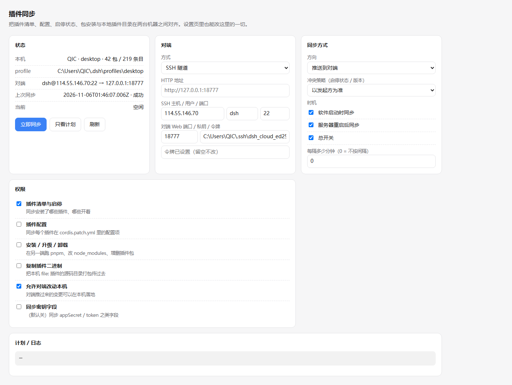
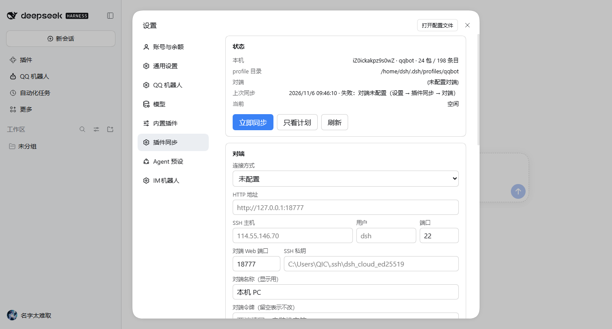

# @qic-9821/dsh-plugin-sync

让两台机器上的 **DeepSeek Harness 插件状态** 保持一致：装了什么、开着还是关着、配置是什么、本地插件目录要不要一起搬过去。

npm：[`@qic-9821/dsh-plugin-sync`](https://www.npmjs.com/package/@qic-9821/dsh-plugin-sync) · 仓库：<https://github.com/QIC-9821/dsh-plugin-sync> · MIT



配套：`设置 → 插件同步`（系统设置菜单栏里的独立一页）、`设置 → 插件 → 同步`（Plugins 段内的一页）、独立面板 `http://127.0.0.1:<端口>/plugin-sync`、两个 Agent 工具 `plugin_sync` / `plugin_sync_config`。

## 安装

两台机器各装一次（要同步的两端都必须装，否则对端接口不存在）：

```bash
# 已经解出源码时：把目录交给宿主安装（推荐，会自动写 profile 依赖与 lock）
dsh plugin --profile <profile> add /path/to/dsh-plugin-sync

# 或者从 npm 装
dsh plugin --profile <profile> add @qic-9821/dsh-plugin-sync
```

在 App 里也可以走「设置 → 插件 → 安装」给绝对路径。装完刷新一次页面就会多出 `设置 → 插件同步`；宿主进程不用重启（路由和工具会当场挂上）。

安装后两台机器都要做一次：

1. 打开 `设置 → 插件同步`，填对端（地址或 SSH 主机/私钥）和两端相同的令牌。
2. 改 `direction`（哪边推、哪边收）和要开的权限。
3. 用「只看计划」确认清单再「立即同步」。


## 能同步什么

| 能力 | 开关 | 说明 |
| --- | --- | --- |
| 插件清单与启停 | `capPlugins` | 每台机器装了哪些 bundle、每个 loader 条目开着还是关着 |
| 插件配置 | `capConfig` | `cordis.patch.yml` 里每个 bundle 的 `config:` 段 |
| 安装 / 升级 / 卸载 | `capInstall` | 通过宿主 `pluginManager` 跑 pnpm、改 `package.json` 与 `node_modules` |
| 复制插件二进制 | `capFiles` | 把本机 `file:` 插件的源码目录 tar 过去再装（跨机不需要 git/npm 可达） |
| 允许对端改动本机 | `capRemoteApply` | 关掉后对端连读都读不到 |
| 同步密钥字段 | `capSecrets` | 默认关；`appSecret` / `token` / `*key*` 一律写成 `[redacted]` |

安装、升级、卸载、启停全部走宿主的 `pluginManager` 服务（`installBundle` / `updateBundle` / `removeBundle` / `setBundleEnabled` / `setPluginEnabled`），不自己拼 pnpm 命令行、不手写 profile 的 `package.json`，失败由宿主回滚它自己的改动。

## 怎么连

两台机器都装本插件，然后在各自设置页填对端：

- **HTTP**：直接填对端 Web 地址（要求对端端口可达）。
- **SSH 隧道**：填 `主机 / 用户 / 端口 / 私钥 / 对端 Web 端口`。本插件按需 `ssh -N -L` 开一条本地转发，再走同一套 HTTP 协议——跨公网、对端只监听 127.0.0.1 的情况用这个（云端的 qqbot profile 就是）。

两端都要填 **同一个令牌**。令牌只用于 `/plugin-sync/peer/*` 这一组接口；同一台机器上的设置页用同源请求，不需要令牌。

## 同步时机

- `autoStart`：DSH 启动后约 25 秒跑一轮（等宿主把插件挂完）。
- `autoRestart`：进程重启后再补一轮（约 2 分钟），处理对端还在启动的情况；服务器重启后的同步就是这条。
- `intervalMinutes`：固定间隔（0 = 关）。
- 手动：面板/设置页按钮，或工具 `plugin_sync` `action="run"`。

## 冲突策略

- `local`：以发起方为准（默认）
- `peer`：以接收方为准（不动对端的启停状态）
- `newest`：版本比较，只升不降

`@deepseek-ai/dsh-base`、`@deepseek-ai/dsh-web-app` 和本插件自己永远不参与启停/卸载；`include` / `exclude` 支持精确名字和 `前缀*`。

**宿主自带的包默认不同步。** `@deepseek-ai/*` 下的包是 DSH 自己的组件，两台机器的版本和平台本来就可能不一样（Windows 桌面端 vs Linux 服务器端），推过去只会把对端弄坏。要同步其中某个，就在 `include` 里点名（例如 `include: ["@deepseek-ai/dsh-session-log-*"]`）。

同理，某台机器上「故意关掉」的东西要自己加进 `exclude`：比如桌面端的 `@tencent-connect/dsh-qqbot` 平时是停用的（云端在跑同一个 bot，双开会每条消息回两遍），不排除的话一次 `push` 就会把云端的 QQ 机器人关掉。

## 安全边界

1. 对端接口一律要令牌；没配令牌 = 对端接口全关。
2. 同步到本机的操作还要再过一遍 `cap*` 权限（对端有权限、本机没开，照样落地不了）。
3. 写 `cordis.patch.yml` 前自动备份到 `~/.dsh/plugin-sync/backups/`（带时间戳）。
4. 本机永远只改自己的 profile，不写共享目录；状态文件 `~/.dsh/plugin-sync/state.json` 原子写。

## 状态文件

```
~/.dsh/plugin-sync/state.json     设置 + 上次运行结果
~/.dsh/plugin-sync/backups/       cordis.patch.yml 备份
~/.dsh/plugin-sync/incoming/      从对端收到的插件源码
```

## 工具

- `plugin_sync` — `status` / `plan` / `run`（可带 `direction`）
- `plugin_sync_config` — `get` / `set`（`patch` 合并设置；不返回令牌）

## 排查脚本

宿主多半在别的进程里，改完代码不想重启时用这两个脚本验证：

```bash
node scripts/verify-plan.mjs          # 抓两端快照，用当前 merge.js 打印计划
node scripts/probe-apply.mjs          # 过隧道打一次 /peer/apply（默认一个不存在的行，验证鉴权与错误回报）
```

## 已知边界

- 只同步插件层：workspace、会话、密钥凭据（`.credentials.yaml`）不在范围内。
- `config:` 段的写出是 flow mapping（`config: {"a":1}`），YAML 合法但和原有块状写法不同；无法解析的写法不会被动。
- 安装 `file:` 插件时，对端会收到一份源码副本（排除 `node_modules` / `.git`），路径是本机的 `incoming/` 目录。

## 开发

```bash
node --test test/*.test.js     # 25 个用例，纯 Node，无第三方依赖
node scripts/verify-plan.mjs   # 对真实的两台机器跑一次计划，不落地
```

设置页在 `client.js` 里注册 `settings.section`（id `plugin-sync`，order 16）与 `settings.plugins.tab`；宿主侧路由在 `lib/http.js`，写操作在 `lib/apply.js`，计划器是纯函数 `lib/merge.js`（好单测）。

设置页在云端实例里的样子：



## 许可

MIT © 2026 QIC-9821

